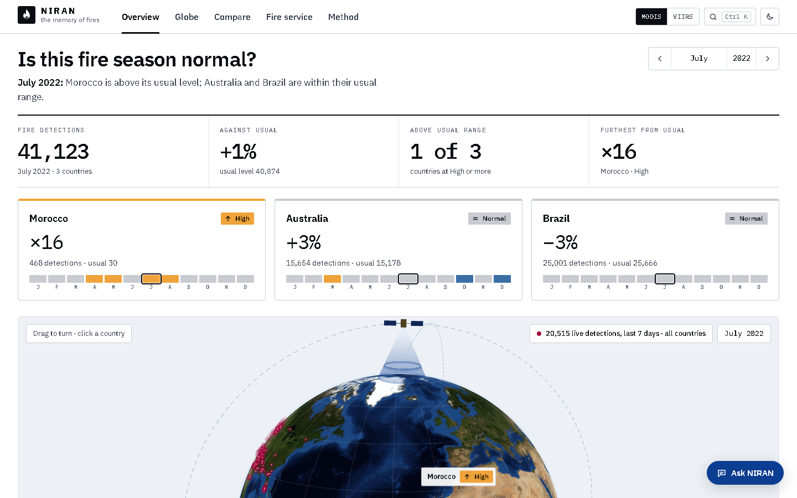
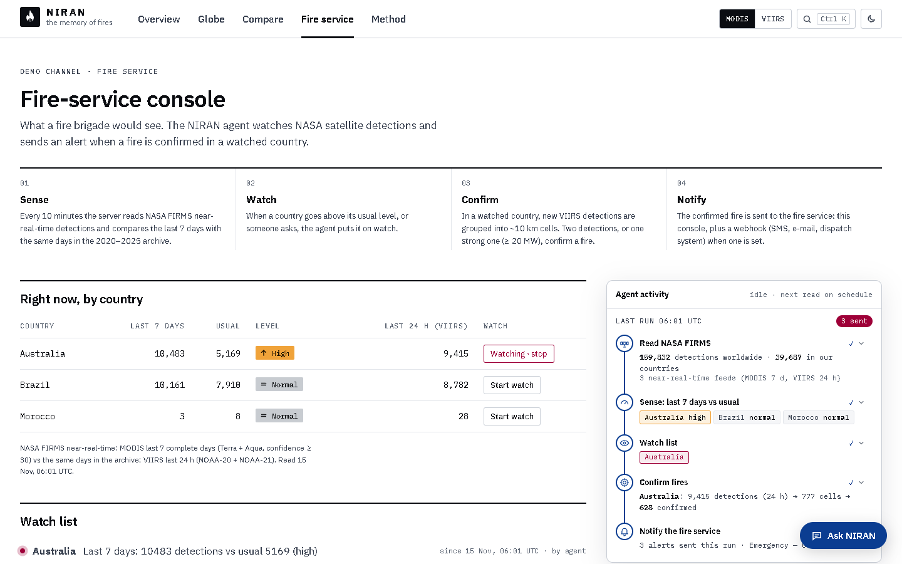

<p align="center">
  
</p>

NIRAN is a wildfire anomaly bulletin and fire-safety agent for Morocco, Australia and Brazil, built only from open NASA data: a 2020–2025 archive plus NASA near-real-time detections.

**Live site:** [niran-the-memory-of-fires.onrender.com](https://niran-the-memory-of-fires.onrender.com/) (free hosting: the first visit can take a minute to wake it)

<!-- video link goes here -->

## What it answers

<p align="center">
  
</p>

### Is this normal?
Each country's fire detections are set against its usual level in the 2020–2025 archive and given a level: low, normal, high, unusual or extreme. MODIS and VIIRS keep separate counts and comparisons.

### When does my country burn?
Country bulletins, year comparisons, seasonal context and a 3D globe that replays the fires show when each country has burned, month by month. This is history, not a forecast.

### What do I do now?
Current fires come from NASA near-real-time data. The agent chat answers from the same facts and gives safety tips. NIRAN does not replace the emergency call: 15 in Morocco, 193 in Brazil, 000 in Australia.

<p align="center">
  
</p>

<p align="center"></p>

## How the agent works

<p align="center">
  
</p>

1. **Read.** Every 10 minutes the server reads the public NASA FIRMS near-real-time files: MODIS for the last 7 days, VIIRS for the last 24 hours. No key is needed.
2. **Sense.** It counts each country's MODIS detections over the last 7 complete days and compares them with the same calendar days in 2020–2025.
3. **Watch.** A country above its usual level goes on the watch list. A person can also add one from the chat or the console.
4. **Confirm.** In a watched country, new VIIRS detections are grouped into 0.1° cells (about 10 km). A cell with two or more detections, or one of 20 MW or more, is a confirmed fire. Each cell alerts once per 24 h.
5. **Notify.** The alert reaches the fire-service console at once. When `ALERT_WEBHOOK_URL` is set, the same JSON, with CAP 1.2 fields, is posted there.

<p align="center">
  
</p>

Details, and how this would run in a real dispatch centre: [docs/AGENT.md](docs/AGENT.md).

## Levels

<p align="center">
  
</p>

The levels, in order: **low → normal → high → unusual → extreme**.

## Data

<p align="center">
  
</p>

| NASA source | Used for |
|---|---|
| **FIRMS** (MODIS, VIIRS) | Fire detections: the 2020–2025 archive behind every count, and the near-real-time feeds the agent reads |
| **POWER** | Monthly weather (temperature, rain, humidity, wind) at each country's main fire areas |
| **GIBS** | Blue Marble imagery and coastlines on the globe; MODIS land cover (MCD12Q1) under the detections |
| **EONET** | Open wildfire events shown on the globe |

The archive is cleaned before use. It keeps type 0 detections only (no volcanoes, fixed sources or sea), MODIS confidence of 30 or more, VIIRS nominal or high confidence, and drops persistent sites (more than 60 days a year in at least 2 years). Counts for every step: [docs/NETTOYAGE.md](docs/NETTOYAGE.md) (in French).

### Data cleaning

<p align="center">
  
</p>

Type and confidence filters are applied before persistent-site removal.
The cleaning report records rows remaining and removed at every step, by country and sensor.

## Limits

- Satellites pass a few times a day. A fire can start and grow between two passes. Clouds and thick smoke hide fires.
- A detection is a hot pixel, not a confirmed wildfire. Farm burning and industry also show up.
- Times shown are the satellite pass (UTC), not when the fire started.
- The 7-day level describes what happened. It is not a forecast.
- In the demo, alerts go to a web console and an optional webhook, not to a real dispatch centre. In a real deployment an operator confirms before crews leave.

<p align="center"></p>

## Run
Prebuilt data is committed in `web/public/data/`, so the site runs without the
raw archives or Python:

```bash
cp .env.example .env          # optional: LLM_API_KEY (DeepSeek V4 Pro by default, or any OpenAI-compatible API), ALERT_WEBHOOK_URL
node server/index.mjs         # API on :8787 (live FIRMS feed, agent, alerts)
cd web && npm ci && npm run dev   # site on :5173, /api proxied to :8787
# npm run build produces web/dist, which the server also serves
```

Docker / Render: `docker build -t niran . && docker run -p 10000:10000 --env-file .env niran`,
or on Render: New → Blueprint (`render.yaml`), then set `LLM_API_KEY` in the dashboard.
Without an LLM key the agent answers with rule-based templates from the same NASA facts.

To rebuild the data, download the MODIS and VIIRS CSV/ZIP archives from
[FIRMS archive](https://firms.modaps.eosdis.nasa.gov/download/) into a folder,
e.g. `data/`. Raw archives, large cleaned exports, caches, dependencies and build
outputs are excluded from Git.

```bash
python -m pip install numpy pandas pillow matplotlib
python pipeline/build_web_data.py --src data     # rebuild web/public/data
# Add --no-nasa to skip NASA weather, land-cover and EONET requests.
```

The `00_*.md`–`06_*.md` team briefs describe the original plan. The current demo
uses country-level regions, 2020–2025 history and an English interface.

## Repository layout
| Path | What |
|---|---|
| `00_*.md` … `06_*.md` | team briefs, one per module (FR) |
| `docs/NETTOYAGE.md` | FIRMS cleaning report |
| `pipeline/` | Python: FIRMS CSVs + NASA APIs → `web/public/data/*.json` |
| `web/` | React + Vite + three.js site (see `web/README.md`) |
| `server/` | Node server (no dependencies): serves the site, live NASA FIRMS feed, NIRAN agent chat, watch → alert loop |
| `docs/AGENT.md` | how the agent senses, watches, confirms and notifies the fire service, and how it would run in real life |
| `docs/readme/` | images for this README: animated SVGs, screenshots of the live site, and the previous README |
| `Dockerfile`, `render.yaml` | one container for Render |
| `analysis/` | earlier cleaning scripts, summary tables, workbook and reference chart |

<p align="center"></p>

## One chain, from orbit to the ground

<p align="center"><code>SIX PEOPLE · ONE CHAIN</code></p>

<div align="center">
<table>
  <tr>
    <td></td>
    <td></td>
    <td></td>
  </tr>
  <tr>
    <td></td>
    <td></td>
    <td></td>
  </tr>
</table>
</div>

<p align="center">Team Mind Scale · NASA Space Apps</p>

## Use of AI tools

<!-- confirm wording -->
AI coding assistants were used to help write code, graphics and text in this repository, including this README and its images. The team reviewed the result.
